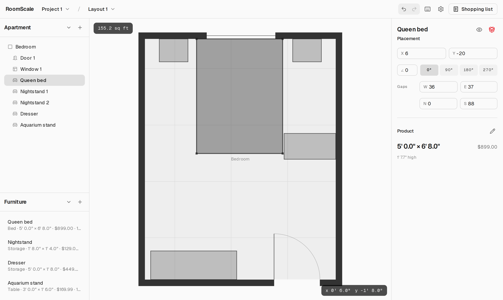

# RoomScale

**Will the furniture fit? Measure once, then find out before you buy.**

RoomScale is a floor planner for one job: you have signed for an apartment,
you have the listing's plan and one visit with a tape measure, and you have to
decide what to buy. Draw the rooms at the sizes you measured, bring furniture
in at the dimensions the retailer printed, and the plan tells you what does
not fit and by how much. What you are left with is a shopping list whose total
you can trust.

It runs entirely in your browser. No account, no server, nothing uploaded.



## What it does

- **Rooms the way a tape reads them.** Type `11' 6"` or `138`, drag a wall and
  watch the size, build an L from two sections, clip a corner, mark a side
  open. Doors, windows, and passages sit on named walls at a distance from a
  corner.
- **Furniture at true size.** Paste a product page and the name, price, and
  dimensions are read out of it, shown with the text they came from, and
  confirmed before they are stored. Or type them. Drag a piece onto the plan,
  turn it, snap it to a wall or another piece, or type its gap to each wall.
- **Answers in inches, not colours.** Overlaps, a piece through a wall, a piece
  in a door's swing, a piece in no room: each is a sentence with the amount.
- **Several layouts of one apartment**, each priced, so arrangements can be
  weighed against each other. Hide a piece to take it off the plan and off the
  bill without losing its place.
- **A shopping list** with quantities, prices, links, and what you have already
  bought, as a page you can print or a spreadsheet you can open.
- **Your data stays yours.** Everything is saved in the browser, and the whole
  project exports as one file you can keep or reopen elsewhere.

## Principles

A render that looks right and measures wrong is the mistake this tool exists
to prevent, so the measurements come first and the picture comes after. Every
value is a number you can type. Lengths are stored in meters and money in
integer cents. The geometry is pure, framework-free, and tested.

## Getting started

Requires Node 20.11+ and pnpm.

```bash
pnpm install
pnpm dev        # http://localhost:3000
```

Before a pull request:

```bash
pnpm verify     # format, lint, types, unit tests
pnpm e2e        # Playwright, for anything user-facing (pnpm e2e:install once)
```

## Layout

```
src/
  app/           Pages
  components/    The workspace, the plan canvas, the panels
  domain/        Pure logic: units, rooms, furniture, geometry, validation
  persistence/   IndexedDB schema and migrations
  state/         The project store
e2e/             Playwright specs
docs/adr/        Architecture decision records
```

`src/domain` has no React, Three.js, Zustand, Dexie, or browser APIs in it,
and ESLint keeps it that way.

## Where it is going

[ROADMAP.md](ROADMAP.md) is the build order, and the
[issues](https://github.com/6uan/room-scale/issues) are what is left in it. A
perspective view comes next, and photorealism last, because neither changes a
measurement.

Not planned: floor-plan recognition, multiplayer, bulk scraping, AR, more than
one floor, checkout.

## Contributing

See [CONTRIBUTING.md](CONTRIBUTING.md). Decisions that constrain the code are
recorded in [docs/adr](docs/adr). Security reports go through
[SECURITY.md](SECURITY.md).

## License

[MIT](LICENSE)
